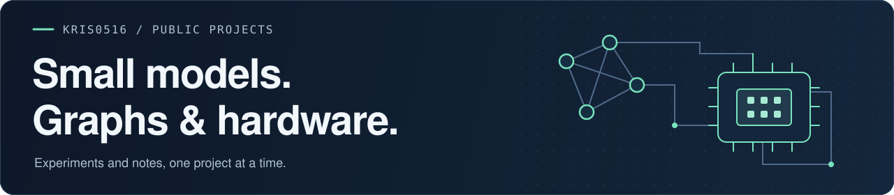

  

## Hi, I'm Kris

I explore small language models, tool use, graph analysis, and AI hardware through hands-on projects. This is where I share experiments, learning notes, and the questions behind them.

`Python` · `Apple MLX` · `NetworkX` · `Jupyter`

### Featured: [ToolAlign](https://github.com/kris0516/ToolAlign)

**Research prototype** for small-model tool use: LoRA post-training, execution-based evaluation, and reproducible experiment reports. Start with the CPU examples, then follow the training and evaluation evidence.

[CPU demo](https://github.com/kris0516/ToolAlign/blob/main/examples/service/README.md) · [Reproduction guide](https://github.com/kris0516/ToolAlign/blob/main/docs/19_REPRODUCTION_AND_DELIVERY.md) · [Results and limitations](https://github.com/kris0516/ToolAlign/blob/main/reports/S1_P06_G5_EVALUATION_R1.md)

What the current results show

SFT improved first-action format validity from **1/28 to 28/28**. Complete-task success remained **0/28 for both the original model and SFT**; DPO has not run. The CPU examples exercise scripted behavior without loading a model. The linked reports explain these boundaries and the observed failures.

### Project index

| Project | What you'll find | Stage |
| --- | --- | --- |
| [ToolAlign](https://github.com/kris0516/ToolAlign) | Small-model tool use, training, and evaluation | Research prototype |
| [MiniGPT from scratch](https://github.com/kris0516/mlx-minigpt-from-scratch) | A step-by-step path from matrix operations to a decoder-only GPT with Apple MLX | Teaching materials in progress |
| [Community detection](https://github.com/kris0516/project2-community-detection) | Louvain and approximate Girvan–Newman analysis of the Caltech Facebook network | Notebook analysis |
| [NPU hardware learning](https://github.com/kris0516/npu-hardware-learning) | A learning path from digital logic through RTL to FPGA and NPU architecture | Learning roadmap |

### Learning now

- How language models turn representations into next-token predictions.
- How to evaluate tool use beyond valid output formats.
- Digital logic and the foundations of AI accelerators.

For questions, corrections, or reproducibility notes, use the relevant repository's issues and contribution guidance.
